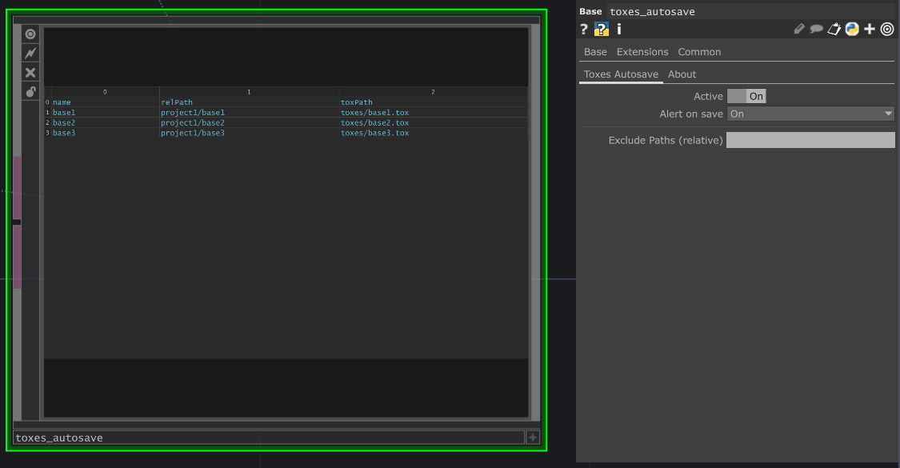
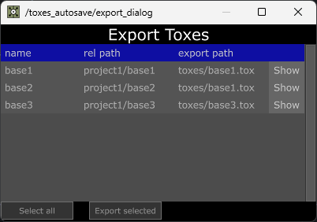
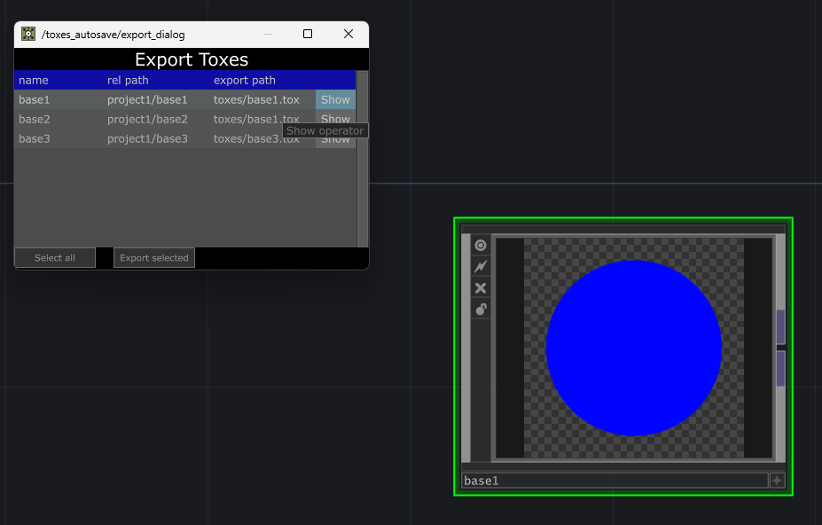
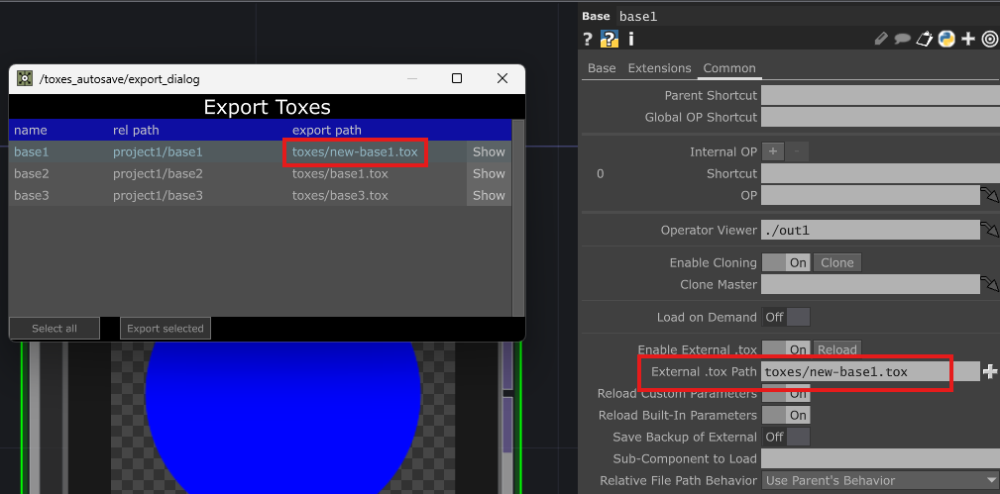
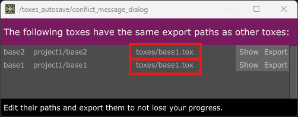
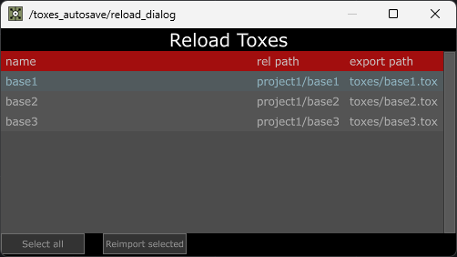

# Toxes autosave

# What is this?

This is a TOX that can be added to your TouchDesigner project to ensure that all of your external operators ("_toxes_" as I call them) are exported when your project is saved.

## What problem does this solve?

When working alone or with a team on big TouchDesigner project, it can be useful to utilise external operators to make the project easier to manage. The main problem when using external toxes is that you need to constantly remember to re-export them when saving to not lose all of your work. This TOX will automatically open a dialog every time the project is saved to allow you to easily export the toxes you've been working on. This way, you won't need to look around your project to find all the toxes that were modified.

# Parameters - Toxes Autosave

### `Active`

- When set to On, the external toxes will be exported on save.

### `Alert on save`

- **"On"** : A dialog will show up on save to allow you to select the external toxes to export.
- **"Always export all"** : No dialog will show up on save. Every external tox will be exported.
- **"Only export modified"** : No dialog will show up on save. Only the external toxes that were modified since the last save will be exported.

### `Exclude Paths (relative)`

- Specify a relative path that should be excluded from the search. Multiple paths can be added by separating them with a space.

# Operator Inputs

### `Input 0`

- (optional) A Table containing the names and relative paths of all the toxes you want to keep track of. All external toxes will be checked by default.

# Features

### `Export Toxes dialog`

- When the **"Alert on save"** parameter is on, the **"Export Toxes dialog"** will appear when the project is saved. You will then be able to select the individual toxes you wish to export. For a tox to be visible on the list, its "Enable External .tox" parameter needs to be set to "On" and it needs to have a relative path in its **"Export .tox path"** parameter.

- The **"Show"** button will automatically set the home view on the selected Tox.

- If you double click on the export path of a tox, you will be able to modify it. The changes made to the dialog will be mirrored on the actual Tox.

### `Conflict dialog`

- When two or more toxes with identical export paths are selected, the **"Conflict dialog"** will appear. With it, you will be able to export only the desired toxes, or edit the export paths in order to export them all without losing progress.

### `Reload dialog`

- If you wish to reload all of your external toxes, you can press **"Ctrl + r"** on your keyboard and the **"Reload dialog"** will appear. You will then be able to select the individual toxes you wish to reload, or reload them all.

### `Set operator as external`

If you want to quickly set an operator as an external tox, you can go inside it and press **"Ctrl + Shift + t"** on your keyboard. This command will open a dialog to select your destination folder and will automatically export the operator using its current name.

This command will also automatically fill the operator's **"External .tox Path"** parameter with the correct relative path and will set the **"Save Backup of External"** parameter to Off.

## Requirments

TD builds > 2025.33070

## Installation.

Download the latest version from the [Release Page](https://github.com/samuelfavreaubdeb/Toxes-autosave/releases). Then, place the TOX file at the root of your project. It should automatically detect your external toxes.

## Tested On

PC

## Release Notes

### 0.2.2

Fix bug caused by disabled parameters

### 0.2.1

Fixing bug with exported CHOP values.
Adding "Exclude Paths" input.

### 0.2.0

Updating the operator for TouchDesigner 2025.

### 0.1.3

Adding "Set operator as external" shortcut

### 0.1.2

Tracking of unsaved files

### 0.1.0

Initial release.

**Enjoy!**
